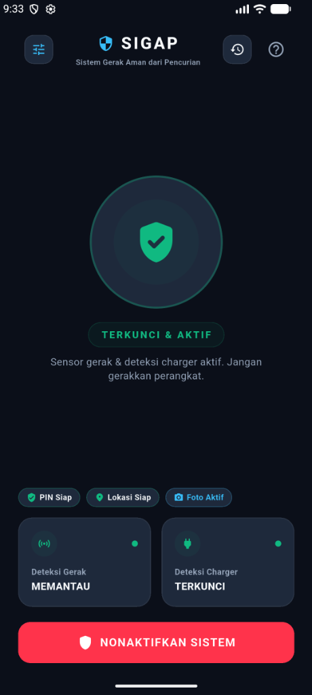
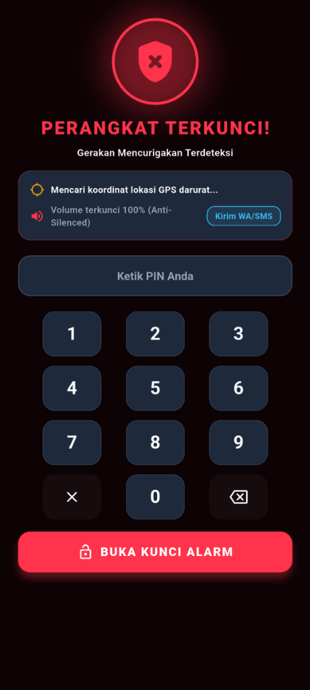
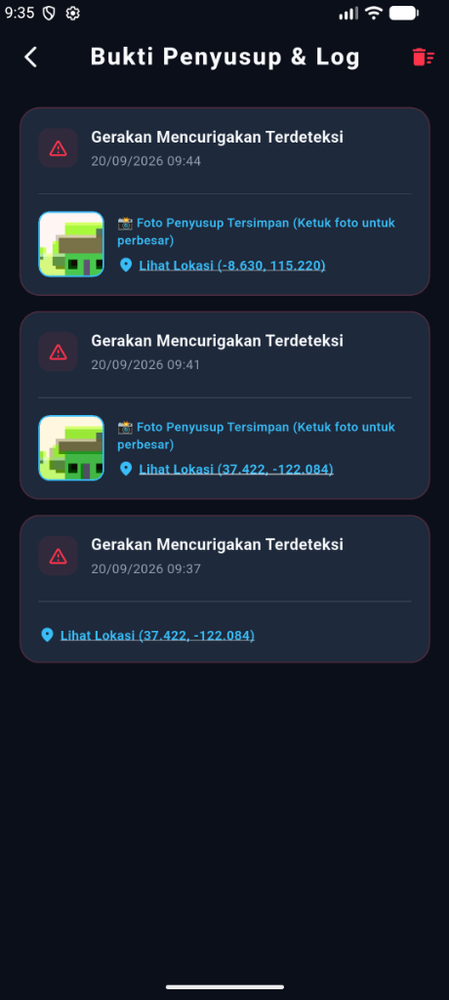

# SIGAP

SIGAP (Sistem Gerak Aman dari Pencurian) adalah aplikasi keamanan perangkat bergerak berbasis Flutter yang dirancang untuk melindungi smartphone dari tindakan pencurian dan pemindahan tanpa izin menggunakan integrasi sensor perangkat keras.

## Tangkapan Layar Antarmuka

| Dashboard Siaga | Layar Darurat Terkunci | Log Bukti Forensik |
|:---:|:---:|:---:|
|  |  |  |

## Fitur Utama

- Deteksi Gerakan (Akselerometer): Memantau posisi aksis perangkat secara kontinu. Pergerakan atau pengangkatan perangkat yang mencurigakan akan langsung memicu sistem alarm.
- Deteksi Pemutusan Pengisi Daya (Charger): Mendeteksi status baterai secara langsung. Pelepasan kabel charger secara paksa akan langsung memicu alarm.
- Waktu Hitung Mundur (Countdown): Jeda waktu 5 detik sebelum sistem siaga aktif, memberikan waktu kepada pengguna untuk meletakkan perangkat secara stabil di permukaan datar.
- Alarm Keras dan Penguncian Volume: Memutar suara alarm darurat secara berulang dan mengunci volume perangkat pada tingkat 100 persen untuk mencegah pembungkaman suara.
- Layar Kunci Darurat dengan Keypad PIN: Mengunci navigasi antarmuka secara penuh saat alarm terpicu. Pengguna wajib memasukkan PIN keamanan numerik yang valid untuk menonaktifkan sistem.
- Pelacakan Lokasi GPS: Mengambil data koordinat geografis terkini saat alarm terpicu dan menyimpannya bersama tautan Google Maps.
- Pengambilan Foto Penyusup: Mengambil foto secara otomatis melalui kamera depan ketika alarm terpicu atau ketika terjadi kesalahan input PIN sebanyak 3 kali.
- Riwayat Insiden dan Bukti: Menyimpan daftar catatan insiden keamanan lokal lengkap dengan cap waktu, jenis pemicu, koordinat lokasi, dan foto bukti.
- Panduan Interaktif: Petunjuk langkah demi langkah mengenai tata cara pengaktifan dan penggunaan aplikasi.

## Kebutuhan Sistem

- Flutter SDK: Versi 3.11.5 atau lebih tinggi
- Dart SDK: Versi 3.11.5 atau lebih tinggi
- Android: Android 5.0 (API Level 21) atau versi yang lebih baru
- Izin Perangkat Keras: Kamera depan, Akses Lokasi (GPS), Getar (Vibrate), dan Sensor Gerak

## Instalasi dan Menjalankan Proyek

1. Klon repositori ini:
   git clone <URL_REPOSITORI>
   cd sensormobile

2. Pasang semua dependensi yang diperlukan:
   flutter pub get

3. Pastikan perangkat atau emulator Android terhubung:
   flutter devices

4. Jalankan aplikasi pada mode pengembangan:
   flutter run

5. Untuk membangun berkas rilis Android (APK):
   flutter build apk --release

## Struktur Direktori Utama

- lib/main.dart: Titik awal aplikasi dan inisialisasi provider utama.
- lib/models/: Model data untuk entitas insiden keamanan (SecurityEvent).
- lib/providers/: Manajemen status keamanan, sensor akselerometer, dan baterai (SecurityProvider).
- lib/screens/: Tampilan antarmuka utama, layar darurat, pengaturan, riwayat bukti, dan panduan.
- lib/services/: Layanan pendukung seperti akses kamera, lokasi GPS, dan penyimpanan lokal.
- lib/utils/: Definisi tema warna, tipografi, dan konstanta aplikasi.
- img/: Berkas aset gambar ilustrasi panduan penggunaan.

## Lisensi

Proyek ini dikembangkan untuk kebutuhan perlindungan keamanan perangkat bergerak. Seluruh hak cipta dilindungi.
